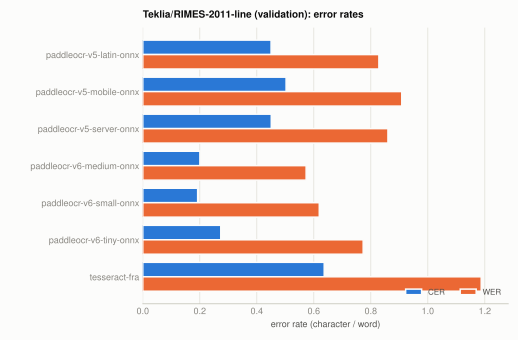
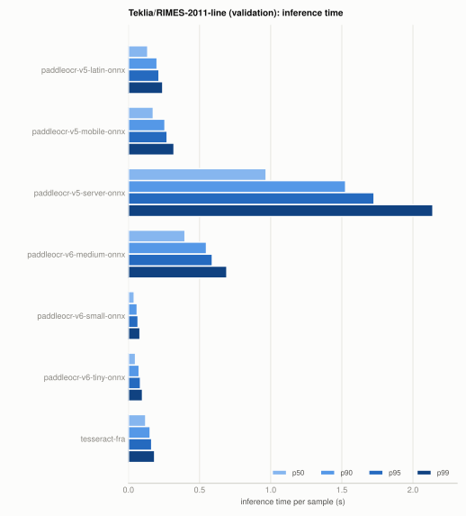
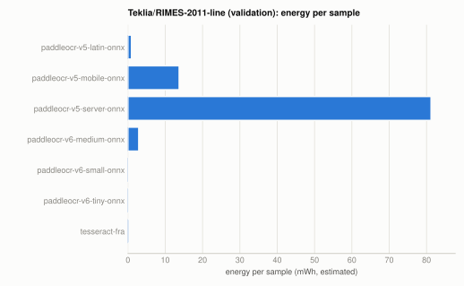
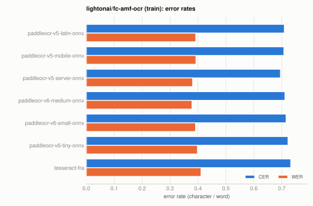
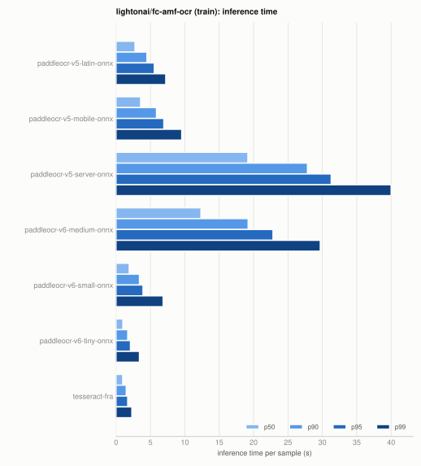
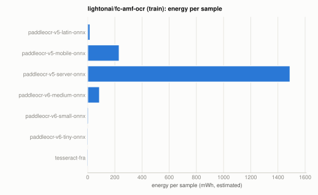
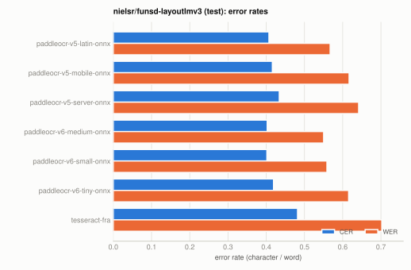
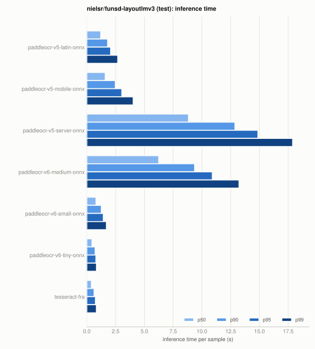
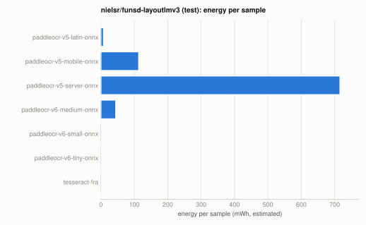
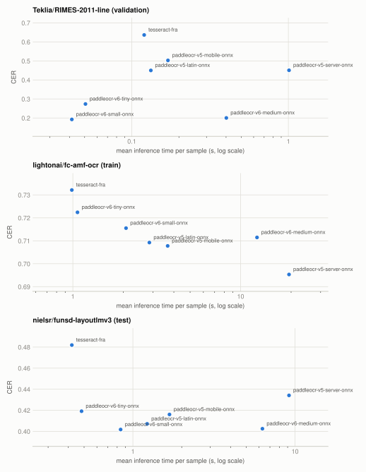

# Models comparison

7 models on 3 datasets, from the reports under this folder. Models are listed alphabetically; nothing here is ranked or interpreted.

## Models

| Model | Backend | Parameters | Hardware |
|---|---|---|---|
| [paddleocr-v5-latin-onnx](paddleocr-v5-latin-onnx/README.md) | `paddleocr_onnx` | det_model=PP-OCRv5_mobile_det, rec_model=latin_PP-OCRv5_mobile_rec, device=cpu | github-ubuntu-latest |
| [paddleocr-v5-mobile-onnx](paddleocr-v5-mobile-onnx/README.md) | `paddleocr_onnx` | det_model=PP-OCRv5_mobile_det, rec_model=PP-OCRv5_mobile_rec, device=cpu | github-ubuntu-latest |
| [paddleocr-v5-server-onnx](paddleocr-v5-server-onnx/README.md) | `paddleocr_onnx` | det_model=PP-OCRv5_server_det, rec_model=PP-OCRv5_server_rec, device=cpu | github-ubuntu-latest |
| [paddleocr-v6-medium-onnx](paddleocr-v6-medium-onnx/README.md) | `paddleocr_onnx` | det_model=PP-OCRv6_medium_det, rec_model=PP-OCRv6_medium_rec, device=cpu | github-ubuntu-latest |
| [paddleocr-v6-small-onnx](paddleocr-v6-small-onnx/README.md) | `paddleocr_onnx` | det_model=PP-OCRv6_small_det, rec_model=PP-OCRv6_small_rec, device=cpu | github-ubuntu-latest |
| [paddleocr-v6-tiny-onnx](paddleocr-v6-tiny-onnx/README.md) | `paddleocr_onnx` | det_model=PP-OCRv6_tiny_det, rec_model=PP-OCRv6_tiny_rec, device=cpu | github-ubuntu-latest |
| [tesseract-fra](tesseract-fra/README.md) | `tesseract` | lang=fra, psm=3, oem=1, threads=1 | github-ubuntu-latest |

## How the numbers were measured

- **CER / WER**: character / word error rate against the dataset reference, after lowercasing and whitespace normalization. Both can exceed 1. They are sensitive to reading order (the reference order is the dataset's, not necessarily the page's).
- **Inference time**: wall time of the model call per sample, with p50 / p90 / p95 / p99 over the evaluated samples; **s/MP** is total time over total megapixels.
- **Energy**: codecarbon estimate per sample (mWh) on the machine running the evaluation; an estimate when CPU power counters are not readable.
- Times and energy are only comparable between reports measured on the same hardware (see the Hardware column). The reference of `lightonai/fc-amf-ocr` is docTR output, not a human transcription.

## Teklia/RIMES-2011-line (validation)

| Model | Samples | CER | WER | Mean (s) | p50 | p90 | p95 | p99 | s/MP | mWh/sample | Date |
|---|---|---|---|---|---|---|---|---|---|---|---|
| [paddleocr-v5-latin-onnx](paddleocr-v5-latin-onnx/Teklia_RIMES-2011-line__validation/README.md) | 1000 | 0.4501 | 0.8284 | 0.132 | 0.136 | 0.202 | 0.215 | 0.241 | 0.621 | 0.96 | 2026-11-12 |
| [paddleocr-v5-mobile-onnx](paddleocr-v5-mobile-onnx/Teklia_RIMES-2011-line__validation/README.md) | 1000 | 0.5028 | 0.9087 | 0.170 | 0.175 | 0.257 | 0.272 | 0.321 | 0.798 | 13.73 | 2026-11-12 |
| [paddleocr-v5-server-onnx](paddleocr-v5-server-onnx/Teklia_RIMES-2011-line__validation/README.md) | 1000 | 0.4508 | 0.8602 | 1.009 | 0.968 | 1.527 | 1.727 | 2.140 | 4.734 | 81.21 | 2026-11-12 |
| [paddleocr-v6-medium-onnx](paddleocr-v6-medium-onnx/Teklia_RIMES-2011-line__validation/README.md) | 1000 | 0.2004 | 0.5731 | 0.402 | 0.398 | 0.549 | 0.590 | 0.692 | 1.884 | 2.90 | 2026-11-12 |
| [paddleocr-v6-small-onnx](paddleocr-v6-small-onnx/Teklia_RIMES-2011-line__validation/README.md) | 1000 | 0.1925 | 0.6192 | 0.041 | 0.041 | 0.062 | 0.068 | 0.081 | 0.194 | 0.23 | 2026-11-12 |
| [paddleocr-v6-tiny-onnx](paddleocr-v6-tiny-onnx/Teklia_RIMES-2011-line__validation/README.md) | 1000 | 0.2736 | 0.7733 | 0.051 | 0.050 | 0.075 | 0.085 | 0.099 | 0.237 | 0.37 | 2026-11-12 |
| [tesseract-fra](tesseract-fra/Teklia_RIMES-2011-line__validation/README.md) | 1000 | 0.6365 | 1.1874 | 0.120 | 0.122 | 0.153 | 0.164 | 0.184 | 0.563 | 0.40 | 2026-11-12 |

<picture>
  <source media="(prefers-color-scheme: dark)" srcset="charts/Teklia_RIMES-2011-line__validation.quality.dark.svg">
  
</picture>

<picture>
  <source media="(prefers-color-scheme: dark)" srcset="charts/Teklia_RIMES-2011-line__validation.latency.dark.svg">
  
</picture>

<picture>
  <source media="(prefers-color-scheme: dark)" srcset="charts/Teklia_RIMES-2011-line__validation.energy.dark.svg">
  
</picture>

## lightonai/fc-amf-ocr (train)

| Model | Samples | CER | WER | Mean (s) | p50 | p90 | p95 | p99 | s/MP | mWh/sample | Date |
|---|---|---|---|---|---|---|---|---|---|---|---|
| [paddleocr-v5-latin-onnx](paddleocr-v5-latin-onnx/lightonai_fc-amf-ocr__train/README.md) | 1000 | 0.7092 | 0.3921 | 2.859 | 2.755 | 4.488 | 5.556 | 7.227 | 1.426 | 17.84 | 2026-11-12 |
| [paddleocr-v5-mobile-onnx](paddleocr-v5-mobile-onnx/lightonai_fc-amf-ocr__train/README.md) | 1000 | 0.7078 | 0.3929 | 3.675 | 3.573 | 5.875 | 6.947 | 9.548 | 1.833 | 232.30 | 2026-11-12 |
| [paddleocr-v5-server-onnx](paddleocr-v5-server-onnx/lightonai_fc-amf-ocr__train/README.md) | 1000 | 0.6953 | 0.3810 | 19.438 | 19.166 | 27.830 | 31.280 | 39.994 | 9.696 | 1489.47 | 2026-11-12 |
| [paddleocr-v6-medium-onnx](paddleocr-v6-medium-onnx/lightonai_fc-amf-ocr__train/README.md) | 1000 | 0.7115 | 0.3786 | 12.527 | 12.345 | 19.204 | 22.819 | 29.691 | 6.249 | 87.49 | 2026-11-12 |
| [paddleocr-v6-small-onnx](paddleocr-v6-small-onnx/lightonai_fc-amf-ocr__train/README.md) | 1000 | 0.7155 | 0.3914 | 2.075 | 1.912 | 3.401 | 3.916 | 6.841 | 1.035 | 7.65 | 2026-11-12 |
| [paddleocr-v6-tiny-onnx](paddleocr-v6-tiny-onnx/lightonai_fc-amf-ocr__train/README.md) | 1000 | 0.7224 | 0.3980 | 1.066 | 0.983 | 1.695 | 2.094 | 3.398 | 0.532 | 5.19 | 2026-11-12 |
| [tesseract-fra](tesseract-fra/lightonai_fc-amf-ocr__train/README.md) | 1000 | 0.7321 | 0.4109 | 0.986 | 0.967 | 1.479 | 1.692 | 2.297 | 0.492 | 3.27 | 2026-11-12 |

<picture>
  <source media="(prefers-color-scheme: dark)" srcset="charts/lightonai_fc-amf-ocr__train.quality.dark.svg">
  
</picture>

<picture>
  <source media="(prefers-color-scheme: dark)" srcset="charts/lightonai_fc-amf-ocr__train.latency.dark.svg">
  
</picture>

<picture>
  <source media="(prefers-color-scheme: dark)" srcset="charts/lightonai_fc-amf-ocr__train.energy.dark.svg">
  
</picture>

## nielsr/funsd-layoutlmv3 (test)

| Model | Samples | CER | WER | Mean (s) | p50 | p90 | p95 | p99 | s/MP | mWh/sample | Date |
|---|---|---|---|---|---|---|---|---|---|---|---|
| [paddleocr-v5-latin-onnx](paddleocr-v5-latin-onnx/nielsr_funsd-layoutlmv3__test/README.md) | 50 | 0.4071 | 0.5672 | 1.224 | 1.208 | 1.808 | 2.068 | 2.685 | 1.602 | 7.96 | 2026-11-12 |
| [paddleocr-v5-mobile-onnx](paddleocr-v5-mobile-onnx/nielsr_funsd-layoutlmv3__test/README.md) | 50 | 0.4160 | 0.6167 | 1.681 | 1.598 | 2.474 | 3.039 | 4.029 | 2.200 | 113.32 | 2026-11-12 |
| [paddleocr-v5-server-onnx](paddleocr-v5-server-onnx/nielsr_funsd-layoutlmv3__test/README.md) | 50 | 0.4342 | 0.6417 | 9.180 | 8.837 | 12.870 | 14.867 | 17.884 | 12.012 | 716.00 | 2026-11-12 |
| [paddleocr-v6-medium-onnx](paddleocr-v6-medium-onnx/nielsr_funsd-layoutlmv3__test/README.md) | 50 | 0.4025 | 0.5502 | 6.292 | 6.248 | 9.364 | 10.902 | 13.224 | 8.233 | 44.56 | 2026-11-12 |
| [paddleocr-v6-small-onnx](paddleocr-v6-small-onnx/nielsr_funsd-layoutlmv3__test/README.md) | 50 | 0.4018 | 0.5588 | 0.840 | 0.797 | 1.261 | 1.433 | 1.701 | 1.099 | 3.12 | 2026-11-12 |
| [paddleocr-v6-tiny-onnx](paddleocr-v6-tiny-onnx/nielsr_funsd-layoutlmv3__test/README.md) | 50 | 0.4191 | 0.6155 | 0.482 | 0.450 | 0.722 | 0.787 | 0.834 | 0.631 | 2.64 | 2026-11-12 |
| [tesseract-fra](tesseract-fra/nielsr_funsd-layoutlmv3__test/README.md) | 50 | 0.4819 | 0.7023 | 0.420 | 0.395 | 0.628 | 0.748 | 0.828 | 0.550 | 1.38 | 2026-11-12 |

<picture>
  <source media="(prefers-color-scheme: dark)" srcset="charts/nielsr_funsd-layoutlmv3__test.quality.dark.svg">
  
</picture>

<picture>
  <source media="(prefers-color-scheme: dark)" srcset="charts/nielsr_funsd-layoutlmv3__test.latency.dark.svg">
  
</picture>

<picture>
  <source media="(prefers-color-scheme: dark)" srcset="charts/nielsr_funsd-layoutlmv3__test.energy.dark.svg">
  
</picture>

## CER against inference time

<picture>
  <source media="(prefers-color-scheme: dark)" srcset="charts/cer_vs_time.dark.svg">
  
</picture>
